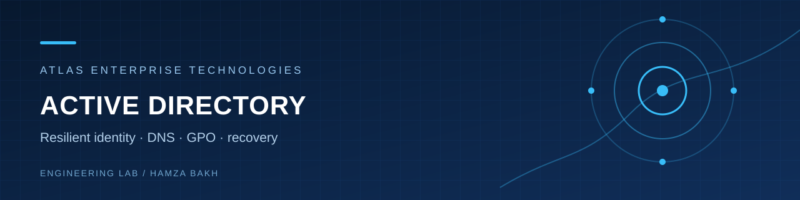
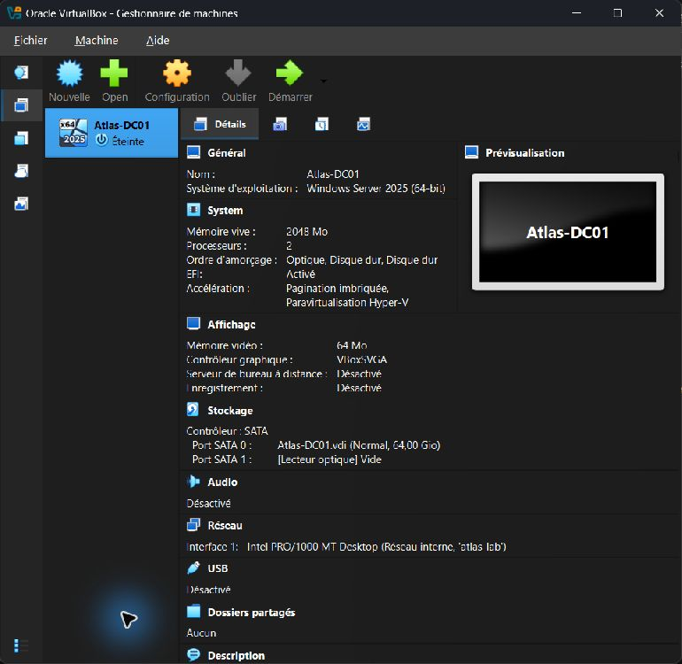

# Enterprise Active Directory Security Lab



[](https://github.com/Hamzabakh1/enterprise-active-directory-security-lab/actions/workflows/offline-validation.yml)

**Atlas Enterprise Technologies · Hamza Bakh · Active Directory and Messaging Infrastructure Engineer portfolio**

> Status: **IMPLEMENTED** offline PowerShell module and synthetic dataset · **TESTED** local parser/Pester/CSV checks (see report) · **DOCUMENTED ONLY** Windows Server deployment · **BLOCKED** live AD integration and recovery drills.

## Project overview and business problem

A fictional 200-person enterprise needs resilient identity, controlled administration and repeatable recovery. This repository defines a two-DC Windows Server domain with segmented access, role-based groups and auditable user lifecycle automation. It includes a deterministic [200-person synthetic dataset](examples/synthetic-data/users-200.csv). It does not claim that a Windows Server forest was deployed on the current host.

## Engineering objectives

1. Deploy two DNS/GC domain controllers and prove replication in an isolated lab.
2. Separate human, service, server and workstation objects; automate six department groups.
3. Diagnose common DNS, GPO, replication and file access failures using evidence-first runbooks.
4. Preserve safe defaults in provisioning and recovery procedures.

## Architecture overview and diagram


This editable SVG is the reference design. It shows planned components and is separate from the verified host evidence below.

Domain: `corp.example.test`. DC01 and DC02 are designed for the DC segment; FS01 serves department shares; MGMT01 is the administration entry point; CLIENT01 validates policy. [Full architecture](ARCHITECTURE.md) and [editable topology source](assets/diagrams/ad-topology.mmd).

## Technology stack and infrastructure requirements

Windows Server 2025 or 2022, AD DS, DNS, DHCP on a separate approved server, GPO, SMB, Windows PowerShell 5.1, RSAT, Pester and GitHub Actions. See [prerequisites](PREREQUISITES.md) and [environment audit](ENVIRONMENT_AUDIT.md). The local pilot workstation cannot validate the full reference topology.

## Security architecture

Dedicated management segment, least privilege, protected OUs, global department groups, explicit NTFS/share permissions, separate service accounts, privileged membership monitoring and tested recovery. Use a lab-specific initial password supplied as `SecureString`; never store it in CSV. [Security controls](SECURITY.md).

## Installation and configuration walkthrough

Read [deployment](DEPLOYMENT.md), then [configuration](docs/configuration/CONFIGURATION.md). The DC installation scripts require `-ApprovedLab`, the exact host names and explicit confirmation. They have **not** been run on Windows Server here.

## Automation examples

```powershell
Import-Module ./scripts/automation/AtlasAD.psm1
New-AtlasOrganizationalUnits -WhatIf
New-AtlasSecurityGroups -WhatIf
$initial = Read-Host 'Lab-only initial password' -AsSecureString
Import-AtlasUsers -CsvPath ./examples/synthetic-data/users.csv -InitialPassword $initial -WhatIf
Get-AtlasFSMORoles
Get-AtlasReplicationHealth
```

The `-WhatIf` examples require an actual isolated `corp.example.test` domain even though they do not write. The local CSV validator and dataset generator work without one.

## Screenshots and verified evidence

The screenshot below was captured from the local VirtualBox manager on 2026-10-21. It proves only that the `Atlas-DC01` VM shell is configured, powered off, and has an empty optical drive. Windows Server, AD DS, DNS, replication, and GPO are **not** shown or claimed.



The [screenshot manifest](SCREENSHOT_MANIFEST.md) records its scope and the remaining captures. The actual command output is preserved as text: [Pester](tests/evidence/pester.txt), [Python unit tests](tests/evidence/unittest.txt), [PowerShell parser](tests/evidence/parser.txt), and [200-user CSV check](tests/evidence/csv-200.json). The [GitHub Actions run](https://github.com/Hamzabakh1/enterprise-active-directory-security-lab/actions) verifies the published branch. No terminal screenshot is presented as operational AD evidence.

## Testing methodology

PowerShell parser, four offline Pester tests and CSV validation run locally. AD integration, GPO application, replication and recovery tests await lab access. See [testing](TESTING.md).

## Troubleshooting scenarios and disaster recovery

Five isolated runbooks cover DNS login failure, GPO nonapplication, replication failure, lost share access and DC outage. Follow [troubleshooting](TROUBLESHOOTING.md) and [recovery design](docs/recovery/RECOVERY.md). Do not induce faults on a production domain.

## Lessons learned and engineering trade-offs

DNS and replication are upstream dependencies of most apparent login failures. A second DC improves availability but introduces replication state that must be monitored. Broad admin rights simplify setup but increase blast radius; the design uses a controlled management path. The local module's strict domain guard improves safety but must be adapted before using a different isolated forest.

## Technical interview talking points

Explain why the client must use AD-integrated DNS, how DC locator and Kerberos depend on SRV records, why GPO processing can fail even with successful authentication, and how to decide between authoritative/non-authoritative restore. The [French interview package](INTERVIEW_PREPARATION_FR.md) contains 30 questions and presentation scripts.

## Future improvements

Deploy an isolated Windows Server lab, add authenticated health evidence and screenshots, test System State recovery, add Pester 5/PSScriptAnalyzer CI, and evaluate Windows LAPS and privileged access workstations.
